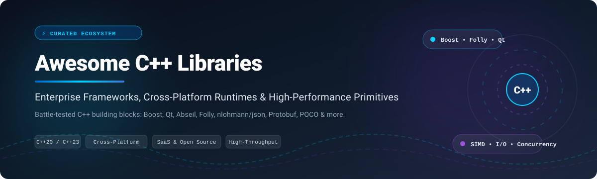

# ⚡ Awesome C++ Libraries & Frameworks

  

  
  
  
  
  

---

## 🚀 Overview & Ecosystem Scope

Welcome to the ultimate curated directory of **C++ Libraries, Frameworks, and Developer Platforms**. Modern C++ (C++17, C++20, and C++23) powers high-throughput distributed systems, game development engines, embedded devices, trading infrastructure, machine learning runtimes, and real-time graphics pipelines.

This repository tracks notable **commercial SaaS platforms, developer runtime tooling, and top-tier open-source GitHub projects**. Whether building ultra-low-latency financial networking systems or cross-platform desktop applications, these libraries provide production-tested primitives without having to reinvent core infrastructure.

---

## 📑 Table of Contents

- [📊 Sector Overview & Market Dynamics](#-sector-overview--market-dynamics)
- [💼 SaaS & Commercial Hosted Platforms](#-saas--commercial-hosted-platforms)
- [⭐ Open-Source GitHub Projects](#-open-source-github-projects)
  - [Top Starred Ecosystem Leaders](#-top-starred-ecosystem-leaders)
  - [Specialized Frameworks & Portability Layers](#-specialized-frameworks--portability-layers)
- [📈 Star History](#-star-history)
- [🤝 How to Contribute](#-how-to-contribute)
- [💖 Support](#-support)
- [⚠️ Disclaimer](#-disclaimer)

---

## 📊 Sector Overview & Market Dynamics

The global C and C++ software development tools and IDE ecosystem is estimated at **$5.1 billion** (projected to exceed **$10.8 billion** by 2032 with a CAGR of ~8.5%), situated within the broader **$8+ billion** software engineering developer tools market. 

The sector exhibits **moderate fragmentation** with a bifurcated dynamic:
- **Core Toolchain & IDE Tier (Highly Concentrated)**: Heavily consolidated around dominant players—notably Microsoft (MSVC / Visual Studio), The Qt Company, and LLVM/GCC ecosystems—where massive network effects, IDE integration, and enterprise LTS contracts dominate commercial spend.
- **Library & Middleware Tier (Moderately Fragmented)**: Highly diverse and open-source driven. Rather than a winner-take-all outcome, specialized domain niches (e.g., OpenCV for computer vision, nlohmann/json for serialization, gRPC/Protobuf for RPC, JUCE for audio, and Abseil/Boost for general primitives) thrive side-by-side with no single framework monopolizing modern C++ application stacks.

---

## 💼 SaaS & Commercial Hosted Platforms

| Platform | Provider / Company | Valuation / Revenue | Starting Pricing | Free Tier Limits | Description |
| --- | --- | --- | --- | --- | --- |
| **Microsoft Visual C++ / Visual Studio** | Microsoft Corporation | ~$3.1T valuation / $245B+ annual revenue | $45/user/month (Monthly Subscription) or $499 (Perpetual Standalone) | Free forever via Visual Studio Community: Limited to individual developers, open-source projects, classroom learning, and organizations with ≤$1M annual gross revenue & ≤250 PCs (up to 5 users). | Commercial IDE, runtime distribution, and MSVC toolchain support for modern C++ development with Azure integration. |
| **Embarcadero C++Builder** | Idera, Inc. | ~$3B valuation / ~$250M+ annual revenue | $1,500/developer (Professional perpetual license with 1-yr update subscription) | Free forever via Community Edition: Limited to individual developers and teams of ≤5 developers with annual company revenue under $5,000 USD. Also offers a 30-day fully functional free evaluation trial. | Modern C++ IDE and component framework (VCL & FireMonkey) for cross-platform Windows and iOS/desktop development. |
| **Qt Commercial** | The Qt Company (Qt Group Plc) | ~$1B market cap (€900M+) / €216.3M annual revenue | $495/developer/month ($5,940/year billed annually) for Qt for Application Development (Professional) | 10-day free trial of commercial edition (evaluation only, no commercial/production rights). Alternatively, Qt Community is free forever under open-source (LGPLv3/GPLv3) licensing requiring relinking/source sharing. | Commercial licensing, validated cross-platform runtime builds, LTS releases, and enterprise support/indemnification for Qt. |

---

## ⭐ Open-Source GitHub Projects

All open-source repositories below are sorted in **descending order by GitHub star count**. Star count badges display current community traction and link directly to each repository's stargazers.

### 🌟 Top Starred Ecosystem Leaders

- **[OpenCV](https://github.com/opencv/opencv)**   
  *Open Source Computer Vision Library* (Apache-2.0).  
  The de facto industry standard library for real-time computer vision, image processing, machine learning, and deep neural network acceleration across desktop, mobile, and embedded hardware.

- **[Protocol Buffers](https://github.com/protocolbuffers/protobuf)**   
  *Google's data interchange format and serialization engine* (BSD-3-Clause).  
  Language-neutral, platform-neutral, extensible mechanism for serializing structured data. Extremely fast, lightweight, and used across hyperscale microservices.

- **[JSON for Modern C++](https://github.com/nlohmann/json)**   
  *Intuitive, single-header JSON library for modern C++* (MIT).  
  First-class JSON integration designed to feel like native STL syntax with full type safety, serialization, deserialization, and zero third-party dependencies.

- **[gRPC](https://github.com/grpc/grpc)**   
  *High-performance, open-source universal RPC framework* (Apache-2.0).  
  Connects, distributes, and orchestrates polyglot microservices with bidirectional streaming, pluggable authentication, tracing, and HTTP/2 transport.

- **[GoogleTest](https://github.com/google/googletest)**   
  *Google Testing and Mocking Framework* (BSD-3-Clause).  
  The gold standard for C++ unit testing, test suites, parameterization, XML test report generation, and GoogleMock object stubbing.

- **[Folly](https://github.com/facebook/folly)**   
  *Facebook's open-source library of C++14/17 performance components* (Apache-2.0).  
  Features hyperscale performance primitives: `folly::FBString`, `ConcurrentHashMap`, `PackedSyncPtr`, asynchronous `Future`/`Executor`, `IOBuf` zero-copy buffers, and high-efficiency memory arenas.

- **[spdlog](https://github.com/gabime/spdlog)**   
  *Super fast C++ logging library* (MIT).  
  Header-only / compiled lightning-speed asynchronous and synchronous logging with rich formatting, multi-threading safety, and rotating file sinks.

- **[libuv](https://github.com/libuv/libuv)**   
  *Multi-platform asynchronous event-driven I/O library* (MIT).  
  Powers Node.js and distributed runtimes; offers epoll/kqueue/IOCP event loops, non-blocking TCP/UDP sockets, DNS resolution, and thread-pool execution.

- **[{fmt}](https://github.com/fmtlib/fmt)**   
  *Fast, safe, and extensible formatting library* (MIT).  
  The foundational library behind C++20's `std::format`; provides a type-safe, compile-time checked alternative to `printf` and `iostream`.

- **[Catch2](https://github.com/catchorg/Catch2)**   
  *Modern, C++-native test framework for unit-tests, TDD and BDD* (BSL-1.0).  
  Renowned for natural expression assertion syntax, BDD test sections, fast compilation, and seamless CLI test runners.

- **[Abseil](https://github.com/abseil/abseil-cpp)**   
  *Google's collection of standard library augmentation modules* (Apache-2.0).  
  Extracted from Google's internal monorepo; ships ultra-optimized Swiss Tables (`flat_hash_map`), `absl::StatusOr<T>`, synchronization locks, flags, strings, and 128-bit integers.

- **[RapidJSON](https://github.com/Tencent/rapidjson)**   
  *A fast JSON parser/generator for C++ with SAX/DOM styles* (MIT).  
  Tencent's high-speed parser with SIMD acceleration (SSE2/SSE4.2/NEON), memory pools, and full JSON Schema validation.

- **[ZeroMQ (libzmq)](https://github.com/zeromq/libzmq)**   
  *Universal messaging library with sockets that act like concurrency primitives* (MPL-2.0).  
  Carries messages across inproc, IPC, TCP, TIPC, and multicast; perfect for pub-sub, push-pull, and request-reply pipelines.

- **[POCO C++ Libraries](https://github.com/pocoproject/poco)**   
  *Cross-platform C++ libraries for network- and internet-based applications* (BSL-1.0).  
  Comprehensive network-centric foundation: HTTP/REST servers, WebSocket, SSL/TLS, database abstraction, thread pools, XML/JSON parsing, and configuration management.

- **[EASTL](https://github.com/electronicarts/EASTL)**   
  *Electronic Arts Standard Template Library* (BSD-3-Clause).  
  Engineered specifically for game development and memory-constrained real-time environments with fine-grained custom allocator control and predictable cache friendliness.

- **[JUCE](https://github.com/juce-framework/JUCE)**   
  *Cross-platform audio application framework and DSP plug-in suite* (GPLv3 / Commercial).  
  The industry benchmark for building VST, AU, AAX audio plug-ins, digital audio workstations (DAWs), and real-time interactive synthesizers.

- **[Boost C++ Libraries](https://github.com/boostorg/boost)**   
  *Peer-reviewed portable C++ source libraries* (BSL-1.0).  
  Over 120 individual libraries covering Asio (async I/O), Beast (HTTP/WebSocket), Filesystem, Graph, Spirit parsing, Multi-Index, and lock-free concurrency. The historical foundation for modern ISO C++ standards.

- **[wxWidgets](https://github.com/wxWidgets/wxWidgets)**   
  *Cross-platform GUI library with native platform appearance* (wxWindows Library Licence).  
  Wraps native OS controls on Windows, macOS, and Linux/GTK for genuine native look-and-feel, dockable window systems, and 2D drawing.

- **[CLI11](https://github.com/CLIUtils/CLI11)**   
  *Command line parser for C++11 and beyond* (BSD-3-Clause).  
  Friendly, single-header or modular command-line parser with type safety, subcommands, option groups, and configuration file parsing.

- **[Qt Base (Core / GUI)](https://github.com/qt/qtbase)**   
  *Base components of the Qt cross-platform framework* (LGPLv3 / GPLv3 / Commercial).  
  Provides object properties, signals & slots, guarded pointers, thread pools, event loops, and internationalization primitives.

- **[gflags](https://github.com/gflags/gflags)**   
  *C++ library that implements commandline flags processing* (BSD-3-Clause).  
  Google's battle-tested command-line argument configuration tool used across distributed clusters.

- **[BDE (Bloomberg Development Environment)](https://github.com/bloomberg/bde)**   
  *Bloomberg's enterprise-grade core C++ foundation* (Apache-2.0).  
  Powers mission-critical financial trading applications with multi-tier memory allocation models, scalable containers, and deterministic thread facilities.

- **[Apache Portable Runtime (APR)](https://github.com/apache/apr)**   
  *Portability layer and runtime utilities for high-reliability software* (Apache-2.0).  
  Provides underlying OS abstractions for network sockets, process control, file operations, thread synchronization, and shared memory used in the Apache Web Server.

- **[eckit (ECMWF)](https://github.com/ecmwf/eckit)**   
  *C++ toolkit for climate and numerical weather prediction applications* (Apache-2.0).  
  Offers space-partitioning trees, high-speed serialization, memory-mapped files, and MPI wrappers for high-performance computing clusters.

---

### 🛠️ Specialized Frameworks & Portability Layers

- **[Asio (Standalone)](https://github.com/chriskohlhoff/asio)**  — Standalone cross-platform C++ library for network and low-level I/O programming.
- **[Eigen](https://gitlab.com/libeigen/eigen)** — High-level C++ template library for linear algebra, matrices, vectors, numerical solvers, and related algorithms.

---

## 📈 Star History

---

## 🤝 How to Contribute

Contributions are warmly encouraged! To keep this repository top-quality and reliable:

1. 🍴 **Fork** the repository.
2. 🌿 Create a descriptive feature branch (`git checkout -b feature/add-new-library`).
3. 📝 Update `README.md` following the established sorting order, including star badge links (`https://img.shields.io/github/stars/{owner}/{repo}?style=social&color=white`) linking to `/stargazers`.
4. ✅ Commit with clear messaging and open a Pull Request.

---

## 💖 Support

Thank you for exploring and utilizing the **Awesome C++ Libraries** ecosystem! 🚀

If you found this resource helpful for your projects, architecture planning, or C++ development workflow, please consider:
- ⭐ **Starring** the repository on GitHub
- 🍴 **Forking** and contributing library updates
- 📢 **Sharing** with your fellow developers, engineers, and teams
- ☕ **Buying a coffee & sponsoring ongoing development**: Support this project and other developer tools via the [GitHub Sponsor Dashboard](https://github.com/sponsors/ishandutta2007).

---

## ⚠️ Disclaimer

- This is a community-curated collection intended for educational and architectural research purposes.
- Always inspect library licenses (**MIT, Apache-2.0, BSL-1.0, LGPL, GPL, or Commercial**) to confirm compatibility with your organization's deployment and distribution model.
- Performance profiles and architectural trade-offs differ significantly between frameworks; benchmark within your target runtime environment prior to production commitment.

---

  <b>Built with ❤️ for C++ Developers, Systems Engineers &amp; High-Performance Architects worldwide.</b>

